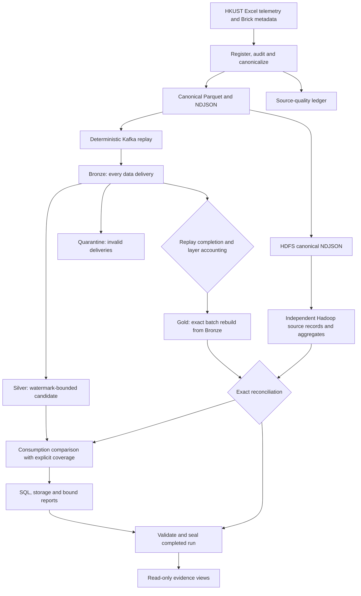

# IoT Energy Data Pipeline

ABV-IIITM IoT Big Data Management coursework using public HKUST smart-meter telemetry.

The pipeline preserves Kafka deliveries, maintains a bounded streaming candidate, rebuilds exact finalized records, and checks them against independently implemented Hadoop computations. The submission includes a project report and a portable dashboard backed by saved experiment evidence.

**[Project report · PDF](docs/submission/project-report.pdf)** · **[Report source](docs/submission/project-report.tex)** · **[Measured results](docs/results/final/course-results.md)** · **[Demonstration guide](docs/demo-script.md)**

## Completed evaluation

| Experiment | Completed scope |
| --- | --- |
| Correctness | Clean, duplicate, delayed, malformed and combined delivery fixtures |
| Recovery | Uninterrupted versus interrupted-and-resumed fixture |
| Watermark | Retaining versus restrictive configuration |
| Scale | Three clean repetitions each at 100K and 1M source records |
| Storage and SQL | NDJSON/Parquet sizes and five queries, with three timing repetitions per query |

All **15 in-scope runs** finalized and passed the recorded exact source-record and aggregate comparisons. The three originally planned 5M runs are excluded because of resource and time constraints. This submission uses those existing results and starts no new experiment workloads.

The combined fixture accounts for **432 deliveries: 144 unique valid records, 144 duplicates and 144 quarantined deliveries**. In the restrictive watermark fixture, Silver contains **143** records while Gold and Hadoop retain **144**. Interrupted and uninterrupted fixture outputs match byte for byte for four semantic artifacts.

Median verification cost was **13.88 minutes at 100K** and **165.30 minutes at 1M**. These figures cover Gold, layer audit, Hadoop and reconciliation. They are not complete workflow durations. All 1M workflows recovered from interruption, and complete workflow timing is unavailable.

## Open the portable dashboard

From a fresh checkout:

```bash
git clone https://github.com/nishantharkut-research/IoT-Energy-Data-Pipeline.git
cd IoT-Energy-Data-Pipeline
python3 -m venv .venv
source .venv/bin/activate
python -m pip install -e ".[dashboard]"
python -m streamlit run dashboard/app.py --server.headless true
```

Open the localhost URL printed by Streamlit. On Windows, activate with `.venv\Scripts\Activate.ps1` instead. Python 3.11 or newer is required. Original distributed-processing dependencies and versions are separate from the portable presentation environment.

The default **Submission results** mode has eight views:

1. Overview and completed scope.
2. Source quality and published-row availability.
3. Delivery conservation by recorded run.
4. Controlled-fault dispositions.
5. Independent source and aggregate comparisons.
6. Watermark behaviour and consumption-comparison coverage.
7. Recovery output hashes.
8. Storage and SQL measurements.

This mode reads small committed files. It needs no dataset, external SSD, Kafka, Spark or Hadoop service. Its loader validates the saved summary bindings and internal count equations. It does **not** reverify original runtime artifacts. The original verification timestamp and its scope remain visible.

To inspect an original sealed run, choose **Sealed run files** and supply its local directory. That mode retains the strict artifact-registry checks and rejects missing, incomplete or altered evidence. Original sealed directories are excluded from Git and must be retained separately.

## Architecture



- **Bronze** archives every data delivery. Terminal partition controls are separate.
- **Silver** provides bounded operational deduplication. A valid late record is not quarantine.
- **Gold** reconstructs valid source events by exact source identity after completion. It does not inherit Silver's watermark omissions.
- **Hadoop** reads canonical NDJSON and imports no Spark transformations. Both implementations share canonical preparation.
- **Finalization** checks delivery conservation, partition termination, exact comparison agreement and artifact bindings.

## Data and interpretation

The dataset is deposited on [Dryad](https://doi.org/10.5061/dryad.k3j9kd5h6) and described in [Scientific Data](https://doi.org/10.1038/s41597-024-04106-1). The [published source audit](docs/results/source-audit-2026-10-27.md) records 63,273,828 resampled rows: 44,238,638 finite numeric readings and 19,035,190 missing numeric cells. This is **69.916% numeric-cell availability over published rows**, not an outage rate or complete temporal-coverage measurement.

Source identifiers use dataset version, variant, relative path, worksheet and physical row. Original numeric/timestamp text and exact scaled values are retained. Raw and resampled variants are not silently combined. Cumulative-kWh semantics follow recorded source evidence. Asia/Hong_Kong is an explicit experimental timezone assumption, not author-confirmed metadata.

The scale runs select source-ID-sorted prefixes from numeric canonical data. They are not continuous meter-day samples. Exact agreement applies to these selected inputs; it does not establish physical meter accuracy or completeness of the original source.

The restrictive watermark changes two consumption periods that have incomparable supports. The comparable-interval discrepancy is zero; total energy error and residual financial exposure remain unknown. Rates of 0.5, 1.0 and 2.0 currency units/kWh are hypothetical scenarios. No actual bill, Indian tariff or demonstrated saving is claimed.

The Indian utility connection is a data-review use case. Evaluation remains HKUST historical telemetry and controlled delivery faults. The coursework contribution is the implemented integration and its evidence, not a new streaming algorithm or a comparison proving superiority over commercial MDMS.

## Evidence and repository layout

| Path | Contents |
| --- | --- |
| `src/iot_energy_pipeline/` | Registration, canonicalization, replay, reconciliation, reporting and orchestration |
| `jobs/spark/` | Streaming layers, exact finalization, audits and benchmarks |
| `jobs/hadoop/` | Independent mapper/reducer and source-record computation |
| `schemas/`, `configs/`, `queries/` | Contracts, declared experiment settings and SQL |
| `dashboard/` | Portable results viewer and strict sealed-run loader |
| `docs/results/final/` | Saved closure JSON, scope, original plan, tables and HTML report |
| `docs/results/submission/` | Input bindings and submission verification records |
| `docs/submission/` | LaTeX report, PDF, screenshots and vector diagrams |
| `tests/` | Unit, property, contract and integration checks |

The source-audit numbers in this checkout come from the committed audit Markdown. The original audit JSON, dataset, complete runtime trees and service volumes are not versioned. A summary hash establishes a byte binding, not authenticity of the original measurement or a fresh full-runtime audit.

## Check the code and rebuild the report

```bash
python -m pip install -e ".[dev]"
python -m pytest tests/unit/test_submission_data.py tests/contract/test_final_evidence_bindings.py -q
```

For the broader non-distributed suite, install the dataset extras in a compatible Python environment (Python 3.11/3.12 for the original PyArrow range), then run `python -m pytest tests/unit tests/contract tests/property -q`. Docker integration checks are separate; do not interpret the portable viewer check as a new distributed experiment.

The report is built with LaTeX. To regenerate figures and actual browser captures, install the report extra with `python -m pip install -e ".[dashboard,report]"`, with Chrome/Chromium available:

```bash
python -m scripts.build_submission_figures
# Keep the dashboard running in another terminal.
python -m scripts.capture_submission_screenshots
cd docs/submission
latexmk -pdf -interaction=nonstopmode -halt-on-error project-report.tex
```

See [the handover guide](docs/HANDOVER.md) for original artifact verification and the distinction between summary review and full reproduction. Historical execution documents are retained for provenance; the final scope and report take precedence over earlier planned work.
