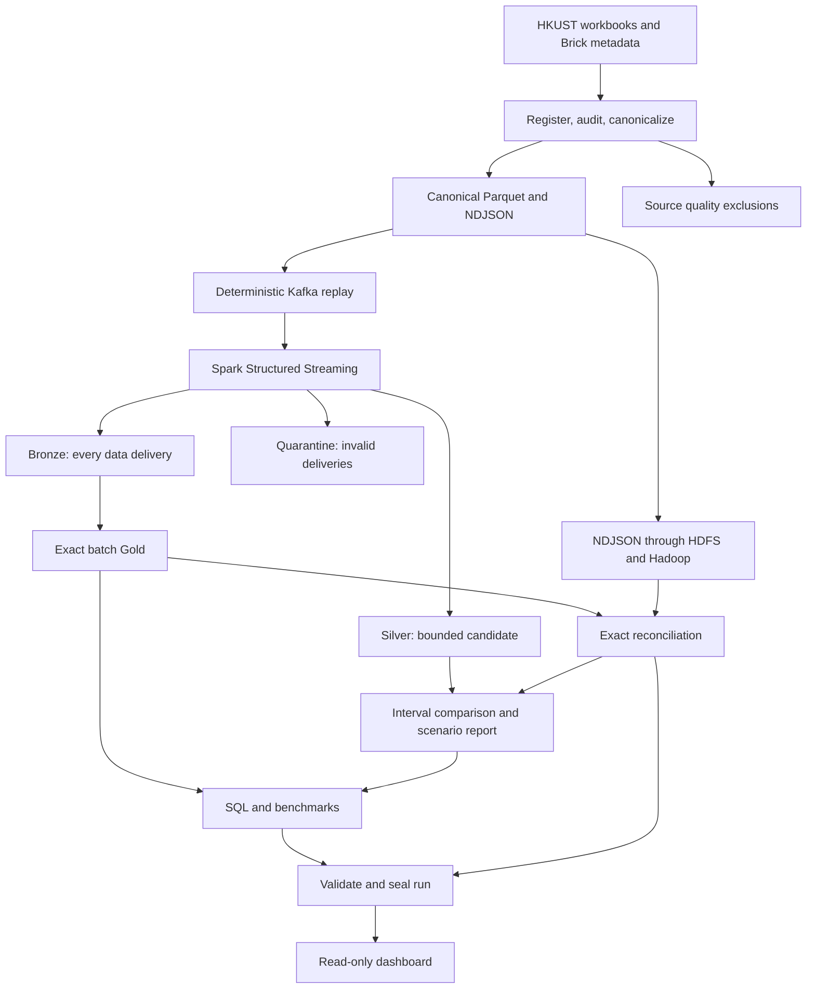

# IoT Energy Data Pipeline

ABV-IIITM IoTBDM coursework using public HKUST smart-meter data.

## Completed coursework scope

All 15 in-scope runs are finalized and independently reconciled: nine
correctness, recovery, and watermark fixtures, plus three repetitions each at
100K and 1M events. The three planned 5M runs are excluded because of resource
and time constraints. No further workloads are required for this scope.

Start with the [project report](docs/course-report.md),
[measured results](docs/results/final/course-results.md), and
[handover guide](docs/HANDOVER.md). Historical execution notes below describe
earlier preparation gates and are superseded by these final results.

All 1M workflows required recovery, so complete workflow timings are unavailable.
Query settings differ between scales. Monetary scenarios do not demonstrate
actual bills or savings.

## Overview

This coursework asks a narrow question: if a distributed data job finishes,
what evidence shows that its answer is complete and correct? The implementation
preserves every Kafka data delivery in Bronze, exposes a watermark-bounded Silver
candidate, rebuilds exact Gold from Bronze after terminal offsets arrive, and
compares Gold with two independently implemented Hadoop Streaming outputs.

The repository is independent coursework and is not affiliated with HKUST.

## Source

Historical dataset files from public HKUST campus smart-meter data.

The downloaded Dryad wrapper can be verified without extraction using
`python -m iot_energy_pipeline.cli verify-package`. Registration, profiling,
source audit, and canonicalization are separate immutable stages. Raw and
cleaned variants are never silently combined, and measurement semantics must
come from a hash-bound evidence-rules file.

## Claims

Performance results require designated-machine experiments and sealed run
manifests. Monetary values are normalized hypothetical scenarios. Consumption
differences cover identical interval supports only; unavailable consumption and
residual exposure remain unknown.

Source preparation results are recorded in
[the source audit](docs/results/source-audit-2026-10-27.md).
Distributed execution and open gates are tracked in
[the execution record](docs/execution-status-2026-10-27.md).
Source counts and synthetic fixture checks are separate from real-data scale
measurements.
The [pre-scale review](docs/pre-scale-review-2026-10-27.md) records the logic
audit, corrections, and remaining execution gates.

## Architecture



Bronze preserves all data deliveries. Silver is a bounded operational view. Gold
rebuilds from Bronze with exact source identity. Hadoop reads canonical NDJSON,
imports no Spark transformations, and emits both exact source records and
aggregates for field-level reconciliation.
Terminal control records are archived separately and checked against the
acknowledged partition offsets before Gold can finalize.

## Prepare the dataset and execution plan

The following commands create contracts or plans; they do not start Kafka,
Spark, Hadoop, Docker, or experiment workloads.

```powershell
.venv\Scripts\python.exe -m iot_energy_pipeline.cli verify-package `
  --package <dryad-wrapper.zip> --output reports/package-verification.json

.venv\Scripts\python.exe -m iot_energy_pipeline.machine_metadata `
  --output reports/machine-metadata.json `
  --execution-context designated_machine `
  --python-version 3.11.9 --docker-version <version> `
  --kafka-version apache/kafka:3.7.1 `
  --spark-version 3.5.1 --hadoop-version 3.4.3

.\scripts\run_experiments.ps1 `
  -SnapshotManifest <snapshot-manifest.json> `
  -MachineMetadata reports/machine-metadata.json
```

Canonical snapshots are created only after an evidence registry has been
reviewed:

```powershell
.venv\Scripts\python.exe -m iot_energy_pipeline.cli canonicalize `
  --manifest <dataset-manifest.json> --root <registered-source-root> `
  --rules <canonicalization-rules.json> --output <snapshot-directory>
```

## Distributed experiments

Execution is separate from planning and requires the exact confirmation phrase
shown below. Run the distributed fixture checks before scale measurements.
The current internal-drive execution is tracked in
`docs/execution-status-2026-10-27.md`.

The distributed acceptance command runs the Spark numeric round-trip check,
five fault cases, two producer-recovery cases, and two watermark cases. It uses
synthetic workbooks and requires no real-data snapshot. Choose a fresh runtime
directory for each attempt; previous artifacts and volumes are retained.

```powershell
.\scripts\execute_fixture_acceptance.ps1 `
  -MachineMetadata reports/machine-metadata.json `
  -RuntimeRoot reports/runtime/fixture-acceptance-01 `
  -Confirm RUN-DESIGNATED-MACHINE-EXPERIMENTS
```

For real-data scale experiments, use the compiled snapshot-bound plan:

```powershell
.\scripts\execute_experiments.ps1 `
  -ExperimentPlan reports/experiment-plan.json `
  -SnapshotDir <snapshot-directory> `
  -MachineMetadata reports/machine-metadata.json `
  -Confirm RUN-DESIGNATED-MACHINE-EXPERIMENTS
```

The executor uses an internal repository runtime directory, never deletes
Docker volumes, and publishes only runs that pass reconciliation, decision
report validation, query/storage benchmarks, and final integrity sealing.

## Verification during implementation

Lightweight checks do not execute the distributed fixture:

```powershell
.venv\Scripts\python.exe -m pytest tests/unit tests/property tests/contract -q
.venv\Scripts\python.exe -m ruff check src jobs dashboard tests scripts
.venv\Scripts\python.exe -m scripts.scan_independence
```

CI runs lightweight checks. The integration tests use local fixtures and
synthetic artifacts; they do not establish that Kafka, Spark, HDFS, or YARN
executed successfully. Distributed acceptance requires broker receipts, Spark
outputs, completed Hadoop jobs, reconciliation, and sealed run manifests.
Full scale workloads are never part of a live demonstration.
Production replay schedules and acknowledgements are streamed NDJSON ledgers.
Canonical sorting, replay ordering, reconciliation, and decision-event ordering
use streaming or disk-backed processing. Decision reports retain affected
periods and flags, so their output size and memory use grow with that population.

Hadoop verifies processing after canonicalization. Agreement cannot establish
the accuracy of source readings or an undocumented timestamp convention.
The current Docker deployment runs on one physical machine.

## Structure

```
IoT-Energy-Data-Pipeline/
|-- src/iot_energy_pipeline/
|-- scripts/
|-- tests/
|-- configs/
|-- docs/
|-- jobs/spark/ and jobs/hadoop/
|-- queries/
|-- schemas/
```

## Documentation

- `docs/dataset-audit.md`: source evidence and bounded archive observations
- `docs/reproducibility.md`: immutable artifact sequence
- `docs/experiment-protocol.md`: fixed matrix and publication gates
- `docs/course-report.md`: completed coursework report
- `docs/demo-script.md`: 5–7 minute demonstration plan
- `docs/results/final/course-results.md`: measured results and evidence limits
- `docs/HANDOVER.md`: dashboard launch and submission guide
